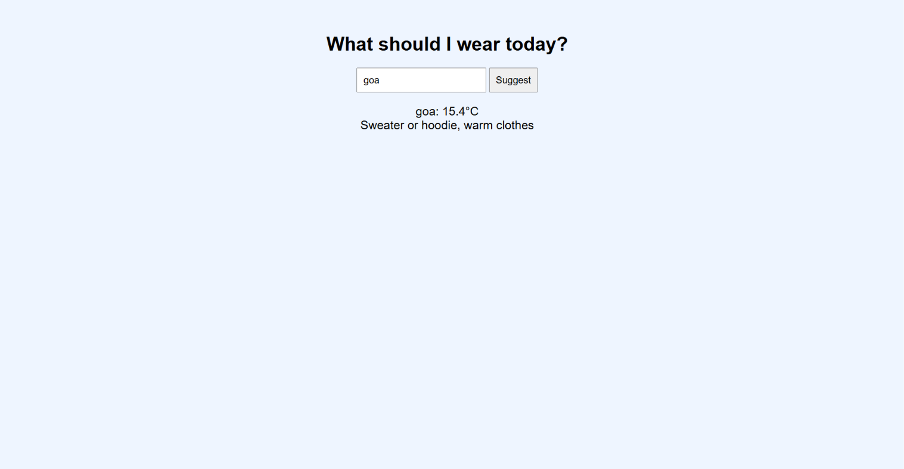

# Weather Outfit Suggester

A web app that suggests what to wear based on the current weather of any city.

## Live Demo
https://keerthana-2-cse.github.io/outfit-suggester

## Features
- Search any city
- Shows the live temperature
- Suggests an outfit for that temperature

## Tech Used
HTML, CSS, JavaScript, Open-Meteo API, GitHub Pages

## How It Works
1. You type a city name.
2. The app finds the city's location using the Open-Meteo Geocoding API.
3. It fetches the current temperature for that location.
4. It picks an outfit based on the temperature range.

## How to Run
Open the live demo link, or download the files and open index.html in a browser.

## Screenshot

## What I Learned
- Calling a public API with fetch() and async/await
- Handling errors (city not found, network failure)
- Deploying a website with GitHub Pages

## Future Improvements
- Rain and wind alerts
- Outfit images
- Suggestions for different occasions

## Author
Keerthana J
